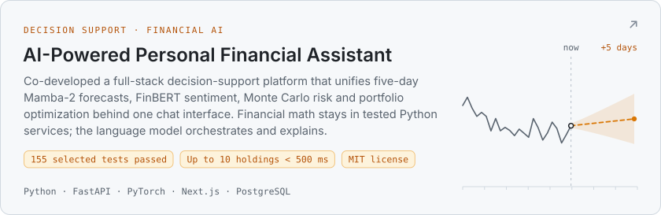
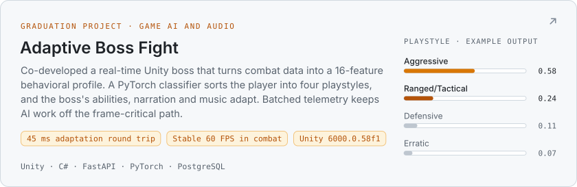
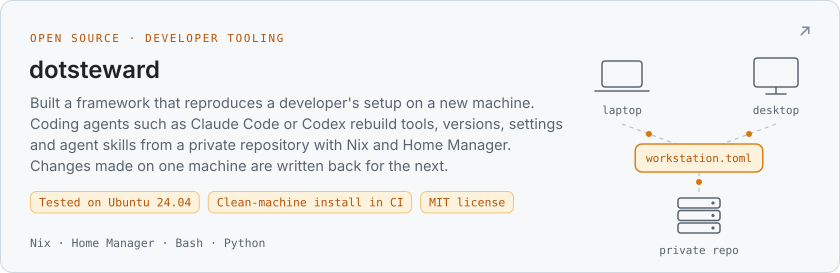
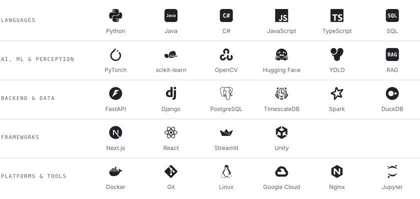

<picture>
  <source media="(prefers-color-scheme: dark)" srcset=".github/readme/assets/profile-hero-dark.svg">
  <source media="(prefers-color-scheme: light)" srcset=".github/readme/assets/profile-hero-light.svg">
  
</picture>

 

  <a href="mailto:ardatuz4@gmail.com"><picture>
    <source media="(prefers-color-scheme: dark)" srcset=".github/readme/assets/contact-email-dark.svg">
    <source media="(prefers-color-scheme: light)" srcset=".github/readme/assets/contact-email-light.svg">
    
  </picture></a>
  <a href="https://www.linkedin.com/in/arda-tuz/"><picture>
    <source media="(prefers-color-scheme: dark)" srcset=".github/readme/assets/contact-linkedin-dark.svg">
    <source media="(prefers-color-scheme: light)" srcset=".github/readme/assets/contact-linkedin-light.svg">
    
  </picture></a>

---

## About Me

I build end-to-end intelligent systems that connect machine learning research with reliable, testable software. I am a senior Artificial Intelligence Engineering student at TOBB ETÜ, pursuing a double major in Computer Engineering and maintaining a GPA above 3.0 in both programs. I am particularly interested in defense technologies, autonomous systems, and applied AI that must operate reliably in complex real-world environments. I aim to contribute to advanced engineering programs at the intersection of artificial intelligence, software systems, robotics, perception, autonomous platforms, and defense technologies.

> I am most interested in the point where an AI model stops being a notebook experiment and becomes a measurable, dependable engineering system.

- **AI & Perception:** computer vision, machine learning, behavioral modeling, RAG, forecasting, generative AI integration
- **Systems & Data:** backend services, relational and time-series storage, real-time telemetry, Spark pipelines, analytical applications
- **Engineering Practice:** modular architecture, explicit data contracts, testing, reproducibility, graceful failure, technical documentation

## Featured Engineering Projects

<a href="https://github.com/Bitirme2025/AI_Financial_Assistant">
  <picture>
    <source media="(prefers-color-scheme: dark)" srcset=".github/readme/assets/card-financial-assistant-dark.svg">
    <source media="(prefers-color-scheme: light)" srcset=".github/readme/assets/card-financial-assistant-light.svg">
    
  </picture>
</a>

 

<a href="https://github.com/Chlorine-Graduation-Group/Adaptive_Boss_Fight">
  <picture>
    <source media="(prefers-color-scheme: dark)" srcset=".github/readme/assets/card-adaptive-boss-dark.svg">
    <source media="(prefers-color-scheme: light)" srcset=".github/readme/assets/card-adaptive-boss-light.svg">
    
  </picture>
</a>

 

<a href="https://github.com/arda-tuz/dotsteward">
  <picture>
    <source media="(prefers-color-scheme: dark)" srcset=".github/readme/assets/card-dotsteward-dark.svg">
    <source media="(prefers-color-scheme: light)" srcset=".github/readme/assets/card-dotsteward-light.svg">
    
  </picture>
</a>

## Technology Stack

<picture>
  <source media="(prefers-color-scheme: dark)" srcset=".github/readme/assets/stack-dark.svg">
  <source media="(prefers-color-scheme: light)" srcset=".github/readme/assets/stack-light.svg">
  
</picture>

 

Also used: PySpark, Mamba-2, FinBERT, ChromaDB.

---

<picture>
  <source media="(prefers-color-scheme: dark)" srcset="https://raw.githubusercontent.com/arda-tuz/arda-tuz/output/snake-dark.svg">
  <source media="(prefers-color-scheme: light)" srcset="https://raw.githubusercontent.com/arda-tuz/arda-tuz/output/snake-light.svg">
  
</picture>

 

Interested in building intelligent systems that are not only impressive in a demo, but reliable under real engineering constraints.

