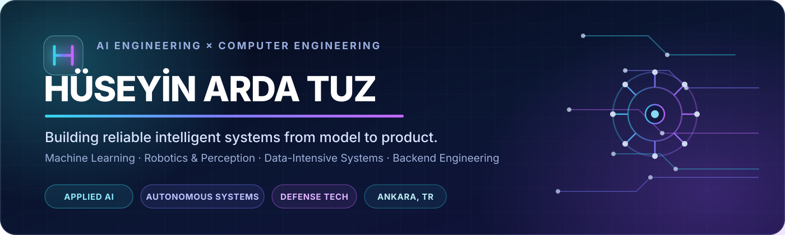
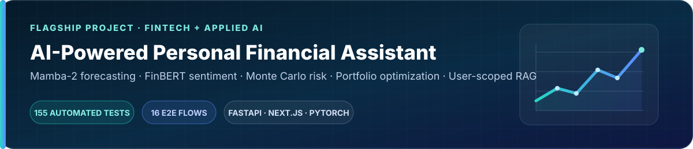
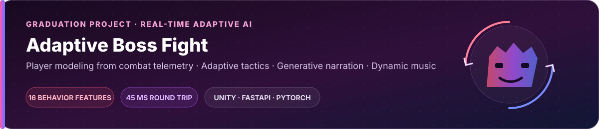
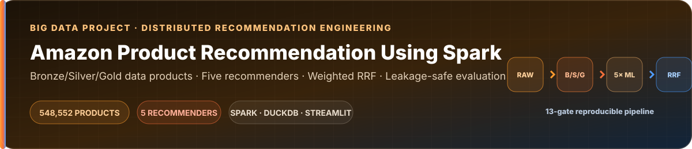

  

  
  
  
  

  <strong>Artificial Intelligence Engineering Student · Double Major in Computer Engineering</strong> 
  TOBB University of Economics and Technology · Ankara, Türkiye

---

## About Me

I build **end-to-end intelligent systems** that connect machine learning research with reliable, testable software.

I am a senior **Artificial Intelligence Engineering** student at **TOBB University of Economics and Technology (TOBB ETÜ)**, pursuing a double major in **Computer Engineering** and maintaining a **GPA above 3.0 in both programs**.

My work spans **computer vision, robotics and perception, real-time telemetry, backend systems, databases, retrieval-augmented generation, and data-intensive recommendation pipelines**. Through long-term internships in **HAVELSAN's Robotics & Perception Team** and **Ordulu Teknoloji's Artificial Intelligence Team**, I have contributed to drone telemetry tooling, GPS/radar/LiDAR data workflows, YOLO-based tracking, OCR model evaluation, and web/backend integration.

I am particularly interested in **defense technologies, autonomous systems, and applied AI that must operate reliably in complex real-world environments**.

> **I am most interested in the point where an AI model stops being a notebook experiment and becomes a measurable, dependable engineering system.**

<table>
  <tr>
    <td width="33%" valign="top">
      <h3>AI & Perception</h3>
      Computer vision, machine learning, behavioral modeling, RAG, forecasting, and generative AI integration.
    </td>
    <td width="33%" valign="top">
      <h3>Systems & Data</h3>
      Backend services, relational and time-series storage, real-time telemetry, Spark pipelines, and analytical applications.
    </td>
    <td width="33%" valign="top">
      <h3>Engineering Practice</h3>
      Modular architecture, explicit data contracts, testing, reproducibility, graceful failure, and technical documentation.
    </td>
  </tr>
</table>

---

## Featured Engineering Projects

Co-developed a full-stack financial decision-support platform that unifies **Mamba-2 stock-direction forecasting, FinBERT sentiment analysis, Monte Carlo risk simulation, portfolio optimization, and user-scoped RAG** behind one conversational experience. The system keeps financial calculations inside deterministic Python services while using the language model for controlled orchestration and explanation.

  
  
  
  

 

Co-developed a real-time Unity boss encounter that converts combat telemetry into a **16-feature behavioral profile**, classifies the player's playstyle with PyTorch, and feeds that interpretation back into boss tactics, narration, and music. Batched telemetry, asynchronous media delivery, caching, and local fallbacks keep expensive AI work outside the frame-critical game loop.

  
  
  
  

 

Co-developed an end-to-end recommendation platform that transforms **548,552 Amazon product records** into auditable rankings through a gate-controlled Apache Spark pipeline. The system combines **ALS, FP-Growth, graph-based, category-based, and Bayesian popularity recommenders** using deterministic weighted Reciprocal Rank Fusion, then serves completed Parquet artifacts through DuckDB and Streamlit without launching Spark from the user interface.

  
  
  
  

---

## Technology Stack

### Languages

  
  
  
  
  
  

### Artificial Intelligence, Machine Learning & Perception

  
  
  
  
  
  
  
  

### Backend, Data & Distributed Systems

  
  
  
  
  
  
  
  

### Product, Platforms & Engineering Tools

  
  
  
  
  
  
  
  
  
  

---

## Selected Industry Experience

### HAVELSAN — Long-Term Intern, Robotics & Perception Team

- Researched, prototyped, and presented robotics algorithms involving GPS and LiDAR data through small-scale validation projects.
- Developed an internal drone telemetry monitoring and testing platform using **Django, JavaScript, and TypeScript** in collaboration with a hardware engineer.
- Implemented real-time sensor visualization, telemetry controls, vehicle tracking, and time-series storage for historical **GPS, radar, and LiDAR** data.

### Ordulu Teknoloji — Long-Term Intern, Artificial Intelligence Team

- Developed a **YOLOv9-based computer vision system** to detect and track aircraft and passengers in airport environments, then iteratively improved its performance from evaluation feedback.
- Evaluated open-source deep-learning OCR models for integration into an existing drone-camera computer vision pipeline.
- Integrated computer vision outputs into the web application backend through a Git-based team workflow.

---

## Education & Direction

<table>
  <tr>
    <td width="50%" valign="top">
      <h3>TOBB University of Economics and Technology</h3>
      <strong>B.Sc. Candidate, Artificial Intelligence Engineering</strong> 
      Double Major in Computer Engineering 
      GPA above 3.0 in both programs
    </td>
    <td width="50%" valign="top">
      <h3>Career Focus</h3>
      I aim to contribute to advanced engineering programs at the intersection of artificial intelligence, software systems, robotics, perception, autonomous platforms, and defense technologies.
    </td>
  </tr>
</table>

---

  <strong>Interested in building intelligent systems that are not only impressive in a demo—but reliable under real engineering constraints.</strong>

  
  

